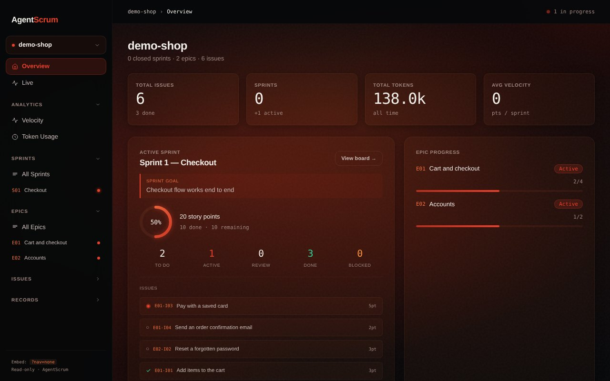
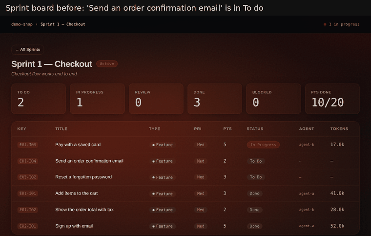
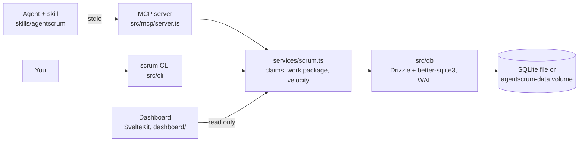

# AgentScrum

**Status: prototype.** It runs Winston's own agent sprints on one machine; there is no hosted version and no auth.

Several AI coding agents on one backlog need a shared sprint board: who owns which issue, what "done" means, and what each session cost. AgentScrum keeps that state in SQLite and serves it to agents through an MCP server, so an agent starts a session with one call, claims an issue, ticks its acceptance criteria, and logs its work while you watch on a read-only dashboard.

- **One call to start a session.** `scrum_get_work_package` returns the sprint goal, the Definition of Done, and every issue the agent can take, with its acceptance criteria, up to a story-point capacity.
- **One owner per issue.** A claim is a single conditional `UPDATE`, so when two agents claim the same issue at once, exactly one wins. Issue numbers stay unique under concurrent writers.
- **A record you can review.** Session logs, blocker reasons, decisions, and lessons feed sprint velocity and token totals on the dashboard.
- **One container.** `docker compose up` migrates the database and starts the dashboard; each agent session starts its own MCP container on the same volume.





Demo data, seeded through the real MCP server by [`docs/media/capture_demo.py`](docs/media/capture_demo.py). The dashboard does not push updates; each GIF frame is a page reload after an agent step.

## Quick Start (container)

You need Docker (Docker Desktop on macOS) and Claude Code. If `~/.claude/skills/agentscrum` already exists, remove it first. Then:

```bash
git clone https://github.com/KoalaLyfestyle/AgentScrum.git
cd AgentScrum
docker compose up -d --build                                       # build, migrate, start the dashboard
claude mcp add agentscrum --scope user -- "$PWD/bin/agentscrum-mcp"  # register the MCP server
mkdir -p ~/.claude/skills && ln -s "$PWD/skills/agentscrum" ~/.claude/skills/agentscrum  # install the skill
docker compose run --rm cli init myproject                         # create your first project
```

Expected: `docker compose ps` shows `dashboard` as healthy, http://127.0.0.1:5180 shows `myproject` with Sprint 1, and `docker compose run --rm cli myproject status` prints the sprint. Data lives in the Docker volume `agentscrum-data`. Always name the project when you run the CLI in the container.

To check the MCP path without Claude Code, run the end-to-end smoke test on a scratch volume (it creates rows, so never point it at real data): `AGENTSCRUM_VOLUME=agentscrum-smoke node scripts/mcp-smoke.mjs -- bin/agentscrum-mcp`.

More: [container.md](docs/container.md) (health check, backup, restore, import, limits), [setup.md](docs/setup.md) (native install with Node 24), and [what an install changes on your machine](docs/setup.md#what-installing-agentscrum-changes-on-your-machine).

## An agent session

```json
scrum_get_work_package { "project_id": 1, "capacity": 20, "agent_id": "builder-1" }
scrum_assign_issue { "issue_id": 3, "agent_id": "builder-1" }
scrum_complete_ac { "ac_id": 7 }
scrum_update_issue_status { "issue_id": 3, "status": "done" }
scrum_log_session { "issue_id": 3, "summary": "...", "tokens_used": 8400, "auditor": "pass" }
scrum_complete_dod_item { "sprint_id": 2, "dod_item_id": 4 }
```

The full loop, the conventions, the CLI fallback, and debug help are in the [agentscrum skill](skills/agentscrum/SKILL.md).

## How it works



All business logic lives in `src/services/scrum.ts`. The MCP server, the CLI, and the dashboard are thin layers over it, and each runs as its own process on the same SQLite file. SQLite in WAL mode with a busy timeout lets those processes write at once; claims and issue numbers use single statements or immediate transactions, so the database itself settles races. In the container, one image plays every role (`migrate`, `dashboard`, `mcp`, `cli`, backup tools), chosen by `docker/entrypoint.sh`.

## Results and limits

- **Tests:** 11 Jest suites and 114 tests for the core, plus 16 Vitest tests for the dashboard. On 19 October 2026, from a fresh clone on Node 22 (this cloud run had no Node 24): 112 core tests pass and 2 fail only because the CLI warns on non-24 Node; all 16 dashboard tests pass.
- **One owner per issue:** `assignIssue` in `src/services/scrum.ts` claims with one conditional `UPDATE ... RETURNING`. `tests/integration/container-roles.test.ts` races two MCP server processes three times and expects exactly one winner each time; the demo above repeats that race. A claim older than 30 minutes can be taken over, so a crashed agent does not hold an issue forever.
- **What the container demo proves:** the image migrates a fresh volume once, the dashboard passes its health check, and separate MCP containers share one database with clean stdout. On 19 October 2026 the image could not be built in this cloud run (base image pull blocked), so the container results are historical, from PR #22.
- **Limits:** one machine and one SQLite file; no auth, so keep the dashboard on `127.0.0.1`. The dashboard's Live view shows invented activity and is a design mock. Claiming, sprint start and close, and acceptance criteria are MCP only for now (#27). A brand-new database opened by several processes at once can still fail its first WAL switch (#33).

## Design note

**A choice:** claims are enforced by SQLite, not by a lock service or a coordinator agent. One conditional `UPDATE` either takes the issue or changes nothing, which works the same across the CLI, many MCP processes, and containers, and needs nothing else running.

**What failed:** when several MCP processes opened a fresh database together, they all ran migrations and the losers crashed with "renumber_log already exists". `migrateRacingOthers` in `src/db/index.ts` now retries, and `tests/integration/number-race.test.ts` checks unique numbering under concurrent writers.

## Who built what

Winston designed AgentScrum, and sprints 1 to 7 (the data model, MCP server, CLI, claims, cost tracking, and the dashboard) are his commits from April 2026. Since October 2026, AI coding agents have written some fixes, the container, and these docs from his issues, and he reviews each pull request before it merges.

## Documentation

| Page | What it covers |
|---|---|
| [skills/agentscrum/SKILL.md](skills/agentscrum/SKILL.md) | The agent workflow: session loop, conventions, story points, DoD, CLI fallback, debug |
| [docs/container.md](docs/container.md) | Container install, roles, backup, restore, import, limits |
| [docs/setup.md](docs/setup.md) | Native install (Node 24), changing Node versions, starting fresh, dashboard, what an install changes and how to undo it |
| [docs/mcp-tools.md](docs/mcp-tools.md) | All 27 MCP tools |
| [docs/cli.md](docs/cli.md) | Project selection, issue and epic keys, every CLI command, vault export |
| [docs/maintenance.md](docs/maintenance.md) | Database location, renumbering, environment variables, development checks |
| [docs/history.md](docs/history.md) | Build history by sprint, open work, and the stack |
