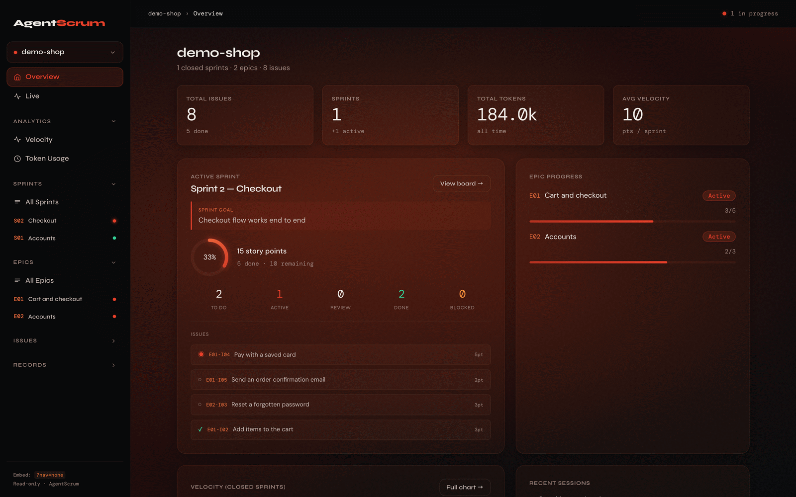
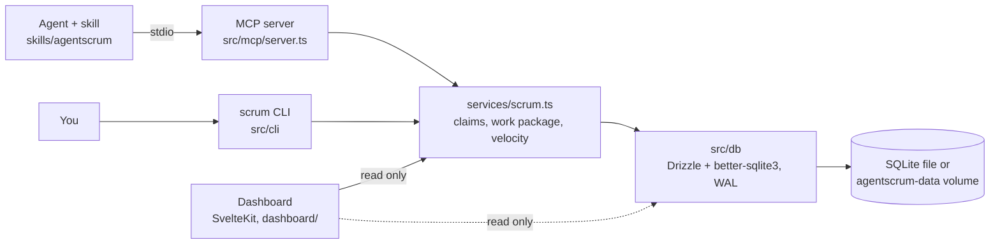

# AgentScrum

**Status: prototype.** It runs Winston's own agent sprints on one machine; there is no hosted version and no auth.

Several AI coding agents on one backlog need a shared sprint board: who owns which issue, what "done" means, and what each session cost. AgentScrum keeps that state in SQLite and serves it to agents through an MCP server, so an agent starts a session with one call, claims an issue, ticks its acceptance criteria, and logs its work while you watch on a read-only dashboard.

- **One call to start a session.** `scrum_get_work_package` returns the sprint goal, the Definition of Done, and every issue the agent can take, with its acceptance criteria, up to a story-point capacity.
- **One owner per issue.** A claim is a single conditional `UPDATE`, so when two agents claim the same issue at once, exactly one wins. Issue numbers stay unique under concurrent writers.
- **A record you can review.** Session logs feed the token totals, and velocity counts the story points of done issues in closed sprints. Decisions and lessons come back in every work package and show on the dashboard. The retro lists blocked issues with their reasons, done issues with open acceptance criteria, expensive issues, and cycle time.
- **One image.** `docker compose up` migrates the database and starts the dashboard; each agent session starts its own MCP container on the same volume.



https://github.com/user-attachments/assets/37e17406-e011-4742-81c9-2e41c2d05274

Demo data, written through the real MCP server by two agent processes. The dashboard does not push updates, so the page reloads after each agent step. Music: "Lobby Time" by Kevin MacLeod (incompetech.com), licensed under CC BY 4.0 (https://creativecommons.org/licenses/by/4.0/).

## Quick Start (container)

You need Docker with Compose v2 (Docker Desktop or OrbStack on macOS) and Claude Code. If `~/.claude/skills/agentscrum` already exists, remove it first. Then:

```bash
git clone https://github.com/KoalaLyfestyle/AgentScrum.git
cd AgentScrum
docker compose up -d --build                                       # build, migrate, start the dashboard
claude mcp add agentscrum --scope user -- "$PWD/bin/agentscrum-mcp"  # register the MCP server
mkdir -p ~/.claude/skills && ln -s "$PWD/skills/agentscrum" ~/.claude/skills/agentscrum  # install the skill
docker compose run --rm cli init myproject                         # create your first project
```

`init` prints `Project created: myproject (id: 1)` and `Sprint 1 created (id: 1, status: planning)`, then asks for Definition of Done items: type some, or press Enter at `DoD 1:` to skip. Then `docker compose ps` shows `dashboard` as healthy, http://127.0.0.1:5180 shows `myproject`, and `docker compose run --rm cli myproject status` prints `Sprint 1 — PLANNING` and `Issues: 0 total`. Data lives in the Docker volume `agentscrum-data`. Always name the project when you run the CLI in the container.

To check the MCP path without Claude Code, run the end-to-end smoke test on a scratch volume. It needs Node on the host, and it creates rows, so never point it at real data. The MCP container never migrates, so migrate the scratch volume first:

```bash
docker run --rm -v agentscrum-smoke:/data agentscrum:local migrate && AGENTSCRUM_VOLUME=agentscrum-smoke node scripts/mcp-smoke.mjs -- bin/agentscrum-mcp
docker volume rm agentscrum-smoke
```

More: [container.md](docs/container.md) (health check, backup, restore, import, limits), [setup.md](docs/setup.md) (native install with Node 24), and [what an install changes on your machine](docs/setup.md#what-installing-agentscrum-changes-on-your-machine).

## An agent session

```json
scrum_get_work_package { "project_id": 1, "capacity": 20, "agent_id": "builder-1" }
scrum_assign_issue { "issue_id": 3, "agent_id": "builder-1" }
scrum_complete_ac { "ac_id": 7 }
scrum_update_issue_status { "issue_id": 3, "status": "done" }
scrum_log_session { "issue_id": 3, "summary": "...", "tokens_used": 8400, "auditor": "pass" }
scrum_complete_dod_item { "sprint_id": 2, "dod_item_id": 4 }
```

The full loop, the conventions, the CLI fallback, and debug help are in the [agentscrum skill](skills/agentscrum/SKILL.md).

## How it works



The business logic lives in `src/services/scrum.ts`. The MCP server and the CLI are thin layers over it, and the dashboard reads through it (its main page also reads the database directly). Each runs as its own process on the same SQLite file. In WAL mode readers never block, and writers queue for up to 5 seconds instead of failing; claims and issue numbers use single statements or immediate transactions, so the database itself settles races. In the container, one image plays every role (`migrate`, `dashboard`, `mcp`, `cli`, `backup`, `restore`, `import`, `counts`, `doctor`), chosen by `docker/entrypoint.sh`.

## Limits

One machine and one SQLite file; no auth, so keep the dashboard on `127.0.0.1`. The dashboard's Live view shows invented activity and is a design mock.

## Design note

**A choice:** claims are enforced by SQLite, not by a lock service or a coordinator agent. One conditional `UPDATE` either takes the issue or changes nothing, which works the same across the CLI, many MCP processes, and containers, and needs nothing else running.

## Documentation

| Page | What it covers |
|---|---|
| [skills/agentscrum/SKILL.md](skills/agentscrum/SKILL.md) | The agent workflow: session loop, conventions, story points, DoD, CLI fallback, debug |
| [docs/container.md](docs/container.md) | Container install, roles, backup, restore, import, limits |
| [docs/setup.md](docs/setup.md) | Native install (Node 24), changing Node versions, starting fresh, dashboard, what an install changes and how to undo it |
| [docs/mcp-tools.md](docs/mcp-tools.md) | All 27 MCP tools |
| [docs/cli.md](docs/cli.md) | Project selection, issue and epic keys, every CLI command, vault export |
| [docs/maintenance.md](docs/maintenance.md) | Database location, renumbering, environment variables, development checks |
| [docs/history.md](docs/history.md) | Build history by sprint, open work, the stack, and [verification and known failures](docs/history.md#verification-and-known-failures) |

If AgentScrum is useful to you, a star or a fork is appreciated.

## License

MIT. See [LICENSE](LICENSE).
